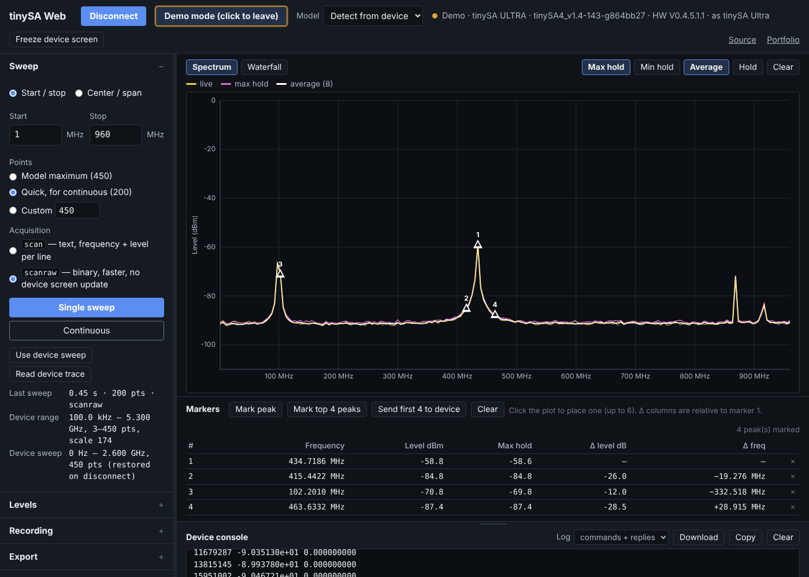

# tinySA Web

A browser front end for the tinySA and tinySA Ultra spectrum analyzers. Plug
the analyzer in over USB, open the page in Chrome or Edge, click Connect: live
spectrum in dBm, a rolling waterfall, max/min hold and averaging, markers with
peak search, RBW and attenuation control, recording and CSV export. Nothing to
install.

**Use it:** https://lc-linkous.github.io/tinysa-web/

The page has a *Try without hardware* mode with a simulated tinySA Ultra, so it
can be previewed anywhere.

<p align="center"></p>

This is the browser companion to the
[tinySA_python](https://github.com/LC-Linkous/tinySA_python) library
(`tsapython`, 4.0.0): same command set, same device profiles, same reply
classification, same output-mode rules, no Python needed. It is also the second tool built on the
[nanovna-web](https://github.com/LC-Linkous/nanovna-web) codebase — see
*Shared with nanovna-web* below for what carried over unchanged.

## How it fits together

The tinySA exposes a text console over USB (`ch>` prompt, one command per
line). Both tools speak that console; they differ only in what is on the other
end of the cable.

```
                           tinySA / tinySA Ultra
                     ┌──────────────────────────┐
                     │  console over USB CDC    │
                     │  ch> scan 0 2e9 450 3    │
                     │  ch> scanraw … · rbw …   │
                     └────────────┬─────────────┘
                                  │  same bytes, same commands
                ┌─────────────────┴─────────────────┐
                │                                   │
        Chrome / Edge                           Python
   ┌────────────────────────┐          ┌────────────────────────┐
   │ tinySA Web             │          │ tinySA_python          │
   │                        │          │                        │
   │ Web Serial API         │          │ pyserial               │
   │   ▼                    │          │   ▼                    │
   │ js/device/             │  mirrors │ tsapython/             │
   │   shell-link.js  ─ ─ ─ ┼ ─ ─ ─ ─ ─┼ ─  core.py (serial)    │
   │   tinysa.js      ─ ─ ─ ┼ ─ ─ ─ ─ ─┼ ─  _commands/*.py      │
   │   models.js      ─ ─ ─ ┼ ─ ─ ─ ─ ─┼ ─  core.py (envelope)  │
   │   ▼                    │          │   ▼                    │
   │ js/plot/  js/ui/       │          │ your script, numpy,    │
   │ live plots, markers,   │          │ matplotlib, automation │
   │ hold, recording        │          │                        │
   └───────────┬────────────┘          └───────────┬────────────┘
               │                                   │
               │        .csv  .json                │
               └──────────────► ◄──────────────────┘
                     files move between the two
```

Reading it top to bottom:

- **The device doesn't know which one it's talking to.** `scan`, `scanraw`,
  `rbw`, `attenuate`, `marker` and the rest are sent as the same strings with
  the same framing rules (echo stripped, single bare `ch>` prompt, trailing
  space on scan lines, no error signalling, the `-:.0` level glitch). Anything
  learned about the protocol on one side goes into the other; `PROTOCOL.md`
  here and the library's notes are kept in step.
- **`js/device/` is a port of the library's device layer** (tsapython 4.0.0):
  `sa.identify()` reads the board, firmware build and `help` list the way
  `identify()` does; `models.js` carries the profiles of `_profiles.py`;
  `classifyReply()` is `classify_reply()`; `sa.setupGenerator()` /
  `sa.setGenerator()` send the generator sequence of `setup_generator()` /
  `set_generator()`, with the same 0.4 s settle, `Command timeout` handling and
  single retry; the RF output is behind the same gate as
  `set_output_allowed()`. `sa.scan(start, stop, pts)` returns the same
  frequency/level pairs as `tsa.scan(...)` with outmask 3, and `sa.scanRaw(...)`
  decodes the binary frame exactly as `plotting_scanraw.py` does.
- **Above that layer they diverge on purpose.** The page is for the bench:
  watch the band, hold the peaks, find the carrier, record. The library is for
  scripts: batch sweeps, fixtures, anything that needs numpy.
- **Files are the hand-off.** The page's CSV export uses the two-column
  `Frequency_Hz,Signal_Strength_dBm` layout of `save_scan_csv.py`, so a file
  from either tool loads in the other (the page draws one as an overlay). The
  waterfall matrix CSV is the browser-side twin of
  `plotting_waterfall_static.py`'s data.

Only one of the two can hold the serial port at a time; close the page's
connection (or the Python script) before starting the other.

## Layout

```
┌──────────────────────────────────────────────────────────────────┐
│ tinySA Web  [Connect] [Demo]  Model ▾  [Analyzer|Generator]      │
│             ● status   4.11 V · resumed   [Freeze device screen]  │
├────────────┬─────────────────────────────────────────────────────┤
│ Sweep      │ Windows [1][2][4]   Smooth  Max  Min  Avg  Hold  Clr │
│  start/stop│ ┌ Spectrum ─────────────┐ ┌ Waterfall ───────────┐   │
│  or ctr/spn│ │                       │ │                      │   │
│  points    │ │        trace          │ │       history        │   │
│  scan /raw │ │                       │ │                      │   │
│  [Single]  │ └───────────────────────┘ └──────────────────────┘   │
│  [Contin.] │ ┌ Peak history ─────────┐ ┌ Generator ───────────┐   │
│ ────────── │ │ level / freq vs sweep │ │ 433.92 MHz  −20 dBm  │   │
│ Levels     │ │                       │ │ nominal output       │   │
│  rbw atten │ └───────────────────────┘ └──────────────────────┘   │
│  lna spur  ├─────────────────────────────────────────────────────┤
│  calc gain │ Markers [peak] [top 4] [send] [ask device]          │
│ ────────── │ # freq* level max −3dB BW Δlevel Δfreq              │
│ Generator  │ band power M1–M2 …                                  │
│  (TX mode) ├─────────────────────────────────────────────────────┤
│ Recording  │ Console ▲ (drag to resize)      Log ▾ [⤓][copy]     │
│ Export     │ > scan 1000000 960000000 450 3                      │
│ Session    │ … 450 lines (1420 ms)                               │
│ Diagnostics│ ┌──────────────────────────────────┐ [Send]         │
│ Dev. tools │ │ type a command                   │                │
│ Settings   │                                                     │
└────────────┴─────────────────────────────────────────────────────┘
```

Each window has its own view tabs; *Windows 1 / 2 / 4* sets how many. The
top-bar **Analyzer / Generator** tabs switch the device between input and
output mode and the sidebar shows only the sections that apply.

The sidebar is an accordion — click a header to open it, click again to
collapse; the choice is remembered. Drag its right edge to resize it
(double-click the edge to reset). The markers table sits between the plot and
the console so it has the full width. On narrow screens the sidebar stacks
above the plot.

## What it does (v0.3)

- **Sweep** — start/stop or center/span in MHz, points by model maximum /
  quick / custom, single or continuous. Two acquisition paths: `scan` (text,
  frequency + level per line, the device screen keeps updating) or `scanraw`
  (binary, about 3× faster, the device screen freezes until the page sends
  `resume`, which it does after a single sweep and when continuous stops).
- **Views, in 1 / 2 / 4 windows** — spectrum (dBm vs frequency, with a
  dashed noise-floor line at the sweep median), waterfall (rolling level
  history, colour range = the level axis), peak history (peak level and peak
  frequency over successive sweeps — the third panel of
  `plotting_waterfall_realtime.py`), and the generator readout.
- **Trace math on the page** — max hold, min hold, power average over the
  last N sweeps (depth in Settings), display smoothing (median 5 or mean 5,
  from `filtering_scan_artifacts.py`; the recording keeps raw data), and
  *Hold* to freeze a copy for comparison. These never touch the device. The
  device's own `calc` modes are in the Levels section if you want them
  applied before the data leaves it.
- **Markers** — click to place up to six; each shows frequency (parabolic
  interpolation between bins when it sits on a peak, marked *), level, the
  max-hold level, −3 dB bandwidth, and Δ level / Δ frequency from marker 1.
  With two or more markers the band power between markers 1 and 2 is shown.
  *Mark peak* finds the highest point; *Mark top 4 peaks* finds the four
  highest local maxima at least 10 dB over the sweep median; *Send first 4 to
  device* writes them to the instrument's own markers by frequency
  (`marker N {Hz}`); *Ask device for peak* runs the instrument's own peak
  search (`marker 1 peak`), reads its markers back, draws them as hollow
  glyphs and shows the difference from the page's peak.
- **Generator mode** — the top-bar tab puts the device in output mode with
  the sequence the firmware needs (`output off`, `mode … output`, `pause`,
  `level`, `sweep cw`, `modulation`, `resume`) and the output **off**. The
  Generator section sets frequency, level (the connected model's range),
  modulation as current firmware spells it (AM/FM with rate, depth and
  deviation on the Ultra family; AM/NFM/WFM/external on the Basic), and each
  change goes between `pause` and `resume`. The output button is live only
  after the arming box ("a load or attenuator is on the RF port") is ticked,
  the same gate as the library's `set_output_allowed(True)`. The Generator
  window shows the nominal output as commanded — the tinySA cannot measure
  its own output, so this is a picture of the settings, not a measurement.
  Switching back to Analyzer turns the output off and returns the device to
  input mode.
- **Levels** — RBW (model-specific list, or auto), attenuation, LNA (Ultra),
  spur removal, the device's trace math (`calc`, with the current words:
  `quasi`, `aver`, and `log`/`lin` on the Ultra family), external gain/loss
  (`ext_gain`). Sent as you change them. A rejected setting shows the device's
  reason instead of looking like success.
- **Device readback** — *Use device sweep* copies the instrument's own
  start/stop/points into the page (`sweep`); *Read device trace* shows what's
  on its screen without starting a new scan (`frequencies`, `data 0`).
- **Recording** — log every sweep with a timestamp while recording is on;
  save as a waterfall matrix CSV (the plot as data), a long sweep log CSV, or
  JSON.
- **Export** — CSV (`Frequency_Hz,Signal_Strength_dBm`), plot PNG, and a
  screenshot of the device's own screen (`capture`, 480×320 on the Ultra,
  320×240 on the Basic).
- **Session & compare** — save/load the whole page state as JSON; load a
  two-column CSV as a dotted overlay under the live trace.
- **Diagnostics** — one button runs a fixed set of commands (including the
  query forms whose usage line carries the current value, and the words that
  changed in 2024–2026 firmware), records raw replies and timings (plus one
  small `scanraw` frame as hex), and downloads a JSON to attach to an issue. This is how the page gets validated against
  hardware it hasn't seen yet. A second button runs `scan` and `scanraw` on
  the same range and reports the offset between them (what
  `plotting_scanraw.py` plots) — a constant offset means the scale factor is
  wrong for that firmware, and the page can apply the suggested value.
- **Top bar** — battery voltage and paused/resumed state (`vbat`, `status`),
  refreshed every 30 s.
- **Device tools** — battery and status readback, touch calibration, touch
  test, the calibration-output reference signal (`caloutput`), and a
  read-only dump of the device's calibration state (`freq_corr`,
  `actual_freq`, `zero`, `vbat_offset`).
- **Console** — the raw serial exchange with a resizable drawer, command
  history (↑ ↓), long replies collapsed, copy button, and a log download
  (commands only, or commands + replies, timestamped).
- **Settings** — dark (default) or light theme; trace colours as the
  instrument convention (yellow trace, magenta max, cyan min) or
  blue/amber/green; reference level and floor (the level axis and the
  waterfall colour range); waterfall palette (Viridis, Inferno, Turbo, Classic
  SDR, Grey); average depth; a `scanraw` scale-factor override for firmware
  the page hasn't seen; overlay on/off; resume-on-disconnect; raw-byte echo
  for debugging framing. All remembered in the browser.

Not yet: zero-span level meter, SD-card browser (`sd_list` / `sd_read`),
trigger setup, generator frequency sweeps. Each is a sidebar section away;
the device layer already has room for them.

## Supported hardware

Built for the tinySA Ultra (ZS405), what the maintainer owns and what the
library's hardware sessions run on (firmware v1.4-143 and v1.4-252). The
Basic (ZS304) and both Ultra+ boards (ZS406, ZS407) have profiles read from the
firmware source, selectable from the Model dropdown and used automatically when
detected, but have not been checked on a real unit. Detection reads `version`
(`tinySA4_…` is the Ultra family; the `HW Version` line names the board) and the
first line of `info` (which prints the board since firmware v1.4-190).

The oldest firmware the page is written for is **v1.4-182** (October 2024),
the same floor as tsapython 4.0.0; older firmware connects with a warning in
the console. The firmware's `help` reply decides which commands the page will
send, so a device that lacks a command gets a clear refusal instead of a
`name?` reply.

Chrome or Edge is required for the USB link — they implement
[Web Serial](https://developer.mozilla.org/en-US/docs/Web/API/Web_Serial_API).
Firefox and Safari can only use the demo.

The tinySA and the NanoVNA-F share the same USB VID:PID, so the port chooser
shows both; the page checks the reply to `version` and refuses a device that
doesn't answer like a tinySA.

## Shared with nanovna-web

This repo was made by copying [nanovna-web](https://github.com/LC-Linkous/nanovna-web)
and replacing the instrument-specific parts. The point was to find out how
much of that codebase is actually generic. Result, by file:

| Unchanged (byte-identical) | Instrument-specific (rewritten) |
|---|---|
| `js/device/shell-link.js` — console framing (see note) | `js/device/tinysa.js`, `models.js`, `demo-link.js` |
| `js/device/serial-link.js` — Web Serial transport | `js/sa.js` (was `rf.js`) — dBm math, peak finding, holds |
| `js/plot/common.js`, `js/plot/palettes.js` | `js/plot/spectrum.js`, `waterfall.js` (was `rect.js`, `smith.js`, `waterfall.js`) |
| `js/ui/sidebar.js`, `js/ui/console.js` | `js/ui/settings.js`, `recorder.js`, `export.js`, `session.js`, `diagnostics.js`, `devicetools.js` |
| `css/layout.css`, `css/components.css` | `js/ui/levels.js`, `generator.js`, `panes.js` (new; replace `calibration.js`, `cw.js`) |
| | `js/plot/peakhist.js`, `css/panes.css` (new) |
| `.github/workflows/pages.yml`, `LICENSE`, `CODE_OF_CONDUCT.md` | `css/theme.css` — only the trace-colour block differs |
| | `index.html`, `js/main.js` |

So the transport, framing, console drawer, sidebar, palettes, layout and
component styles are a reusable kit; everything that knows what the numbers
mean is per instrument. The rule is that the "unchanged" column stays
identical, so a diff between the two repos is the list of instrument-specific
code. `shell-link.js` has changed twice under that rule, each time with
options that default to the NanoVNA behaviour: v0.1 added `quiet` on
`commandBinary`; v0.3 added `requireEcho` and `terminators` on `command()`
(the tinySA's stale-reply and `Command timeout` handling) and serialised all
commands through one queue, so a background poll can no longer interleave
with a user command. The v0.3 change is to be applied to nanovna-web.

## Code layout

No build step; native ES modules.

```
index.html                 markup only
css/
  theme.css                colour tokens: dark/light themes, trace colour schemes
  layout.css               top bar, docked sidebar, plot, console drawer
  components.css           buttons, inputs, tables
  panes.css                the 1 / 2 / 4 window grid and the mode tabs (this repo only)
js/
  main.js                  app state + wiring
  sa.js                    pure math: formatting, peak search, hold/average helpers
  device/                  ← the reusable "library" layer
    shell-link.js          console framing (ch> prompt, echo, binary, one command at a time)
    serial-link.js         Web Serial transport
    demo-link.js           simulated tinySA Ultra ZS405 on v1.4-252, same byte stream
    models.js              device profiles, identifyDevice()
    tinysa.js              TinySA class — method names mirror tsapython 4.0.0
tests/
  device.test.mjs          the device layer over the demo device (node --test 'tests/**/*.test.mjs')
  plot/
    spectrum.js  waterfall.js  peakhist.js  palettes.js  common.js
  ui/
    sidebar.js  console.js  panes.js  settings.js  diagnostics.js
    export.js  levels.js  generator.js  session.js  devicetools.js
    recorder.js
```

`js/device/` is the part another tool would reuse: `main.js` calls
`sa.scan(start, stop, pts)` and gets typed arrays back; it never sees `ch>`.

## Running locally

Module scripts don't load from `file://` in Chrome, so serve the folder:

```sh
python -m http.server 8000
# then open http://localhost:8000/
```

Web Serial works on `localhost`, so a real device can be used this way.

The device layer has tests that run without a browser or a device, against
the demo device's byte stream (Node 18 or later):

```sh
node --test 'tests/**/*.test.mjs'
```

## Validating against a real device

1. Connect, run a single `scan`. If the plot looks wrong or the sweep fails,
   open *Diagnostics* → **Collect sample** and attach the JSON to an issue
   using the *Scan problem* template.
2. Switch to `scanraw` and sweep again. The two traces should sit on top of
   each other; if the binary one is offset by a constant, the scale factor is
   wrong for your firmware — the diagnostic JSON has both, and Settings has an
   override.
3. Compare the page's trace with the device's screen (*Export → Device
   screenshot* pulls that over USB too).

## Contributing

See [CONTRIBUTING.md](CONTRIBUTING.md) and the issue templates. Please read
the short [code of conduct](CODE_OF_CONDUCT.md).

## License

GPL-2.0 — see [LICENSE](LICENSE). Same as the tinySA_python library.

tinySA Web is not affiliated with or endorsed by the tinySA project or its
makers. Refer to the tinySA wiki for anything about the device itself.
